# Предварительные результаты этапов 10–12

**Статус: сокращённое исследование. Полный прогон перенесён в этап 13.** Общее сравнение содержит 30 наблюдений (по 10 SQLi, повышения привилегий и доступа к данным; 5 атак и 5 штатных в каждой группе). Это разведочный срез, после просмотра он считается открытым. Повтор на нём не является новым слепым тестом.

## Ответ на замечание о переобучении

Проблема исходной модели воспроизводится: у архивного LinearSVC на 150 штатных запросах web_app FPR составила 0,7867; замена названий нейтральных полей изменила бинарный сигнал в 2 из 5 проб. Числа относятся к текущему зафиксированному срезу и отличаются от чисел ревьюера по объёму и составу.

У новых маскированных профилей в этих пяти пробах смен сигнала нет. Это ограниченный контроль имён, а не доказательство устранения переобучения. На сокращённом переносе web_app → WordPress новые фиксированные профили дают высокую FPR, обратное направление заметно лучше. Ошибки могут отражать смену домена, ограниченный train и фиксированный порог, а не только классическое переобучение.

**Вывод: исходная зависимость от имён подтверждена; считать проблему переноса решённой пока нельзя.** Основные ML-профили обучены на 2720 примерах; внутренние кривые используют отдельные train/validation группы. Параметры фиксированы, большой подбор прерван по решению пользователя. Данные теста не использовались для улучшения этих профилей после получения результатов.

| Модель | Train F1 | Validation F1 | Разрыв |
|---|---:|---:|---:|
| LogisticRegression | 0,9976 | 0,9010 | 0,0966 |
| LinearSVC | 0,9996 | 0,8966 | 0,1030 |
| RandomForest | 1,0000 | 0,9062 | 0,0938 |

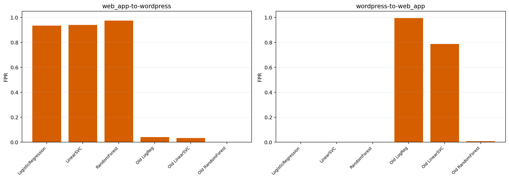

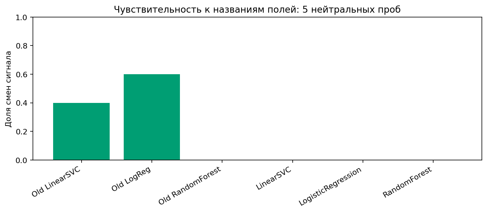

## Общее сравнение

| Метод | Покрытие | F1 | F1 с отказами как ошибками | Recall | FPR |
|---|---:|---:|---:|---:|---:|
| LogisticRegression / sql_only | 1,0000 | 0,5854 | 0,5854 | 0,8000 | 0,9333 |
| LogisticRegression / sql_context | 1,0000 | 0,7368 | 0,7368 | 0,9333 | 0,6000 |
| LinearSVC / sql_only | 1,0000 | 0,6154 | 0,6154 | 0,8000 | 0,8000 |
| LinearSVC / sql_context | 1,0000 | 0,7879 | 0,7879 | 0,8667 | 0,3333 |
| RandomForest / sql_only | 1,0000 | 0,6667 | 0,6667 | 0,9333 | 0,8667 |
| RandomForest / sql_context | 1,0000 | 0,7500 | 0,7500 | 1,0000 | 0,6667 |
| regex_v1 / sql_only | 1,0000 | 0,5517 | 0,5517 | 0,5333 | 0,4000 |
| regex_v2 / sql_only | 1,0000 | 0,4211 | 0,4211 | 0,2667 | 0,0000 |
| policy_only / sql_context | 0,0667 | — | 0,1250 | 1,0000 | — |
| regex_policy / sql_context | 1,0000 | 0,5714 | 0,5714 | 0,4000 | 0,0000 |
| LLM gptoss120 zero_shot | 1,0000 | 0,8276 | 0,8276 | 0,8000 | 0,1333 |
| LLM gptoss120 few_shot | 1,0000 | 0,8148 | 0,8148 | 0,7333 | 0,0667 |
| LLM glm53 zero_shot | 1,0000 | 1,0000 | 1,0000 | 1,0000 | 0,0000 |
| LLM glm53 few_shot | 1,0000 | 1,0000 | 1,0000 | 1,0000 | 0,0000 |
| LLM kimi31pro zero_shot | 1,0000 | 1,0000 | 1,0000 | 1,0000 | 0,0000 |
| LLM kimi31pro few_shot | 1,0000 | 1,0000 | 1,0000 | 1,0000 | 0,0000 |

SQL-only и контекстные профили обозначены отдельно. Все строки используют одни и те же 30 ID. Часть ответов GPT-OSS сохранена из ранее выполненных батчей большого прогона; их происхождение и размеры батчей сохранены. Это не повторное получение тех же ответов в новых батчах.

F1 отсутствует при неполном покрытии. Отказы дополнительно считаются ошибкой соответствующего истинного класса в консервативной оценке; знаменатель не уменьшается. Результаты по угрозам, источникам, диалектам, контексту, длине и обфускации находятся в `analysis.json`. Метрика с одинаковым весом связанных шаблонов показывается отдельно от обычной метрики по строкам.

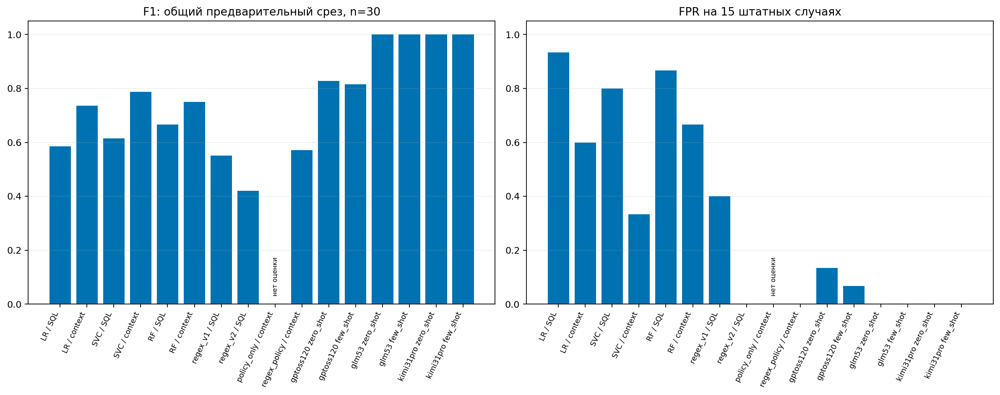

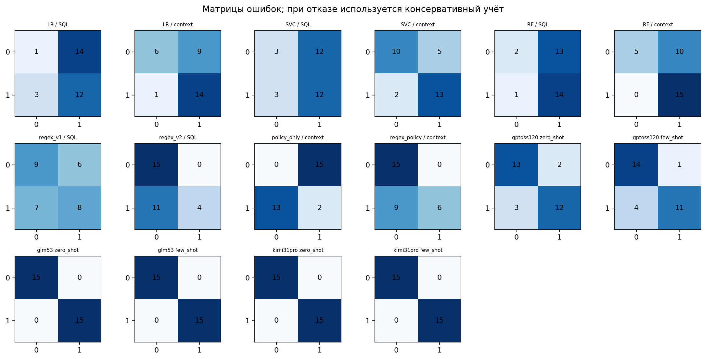

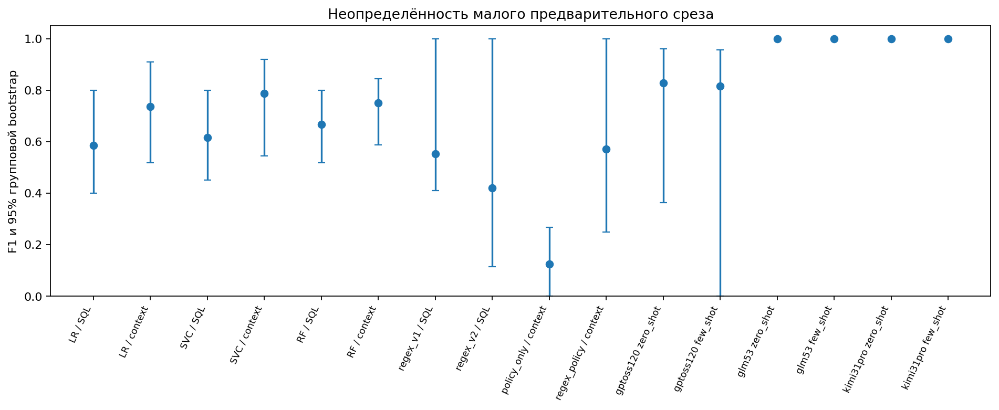

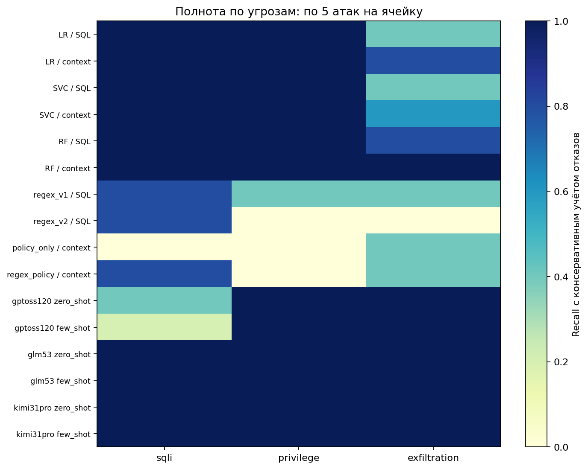

Даже 0 ложных тревог из 15 штатных случаев не подтверждает низкую эксплуатационную FPR: описательная верхняя граница Wilson 95% составляет около 20%. Групповой bootstrap учитывает имеющиеся связанные компоненты, но малое число групп ограничивает выводы. Построчные интервалы Wilson требуют независимости строк и приводятся только как описательный ориентир.

## Диагностические графики

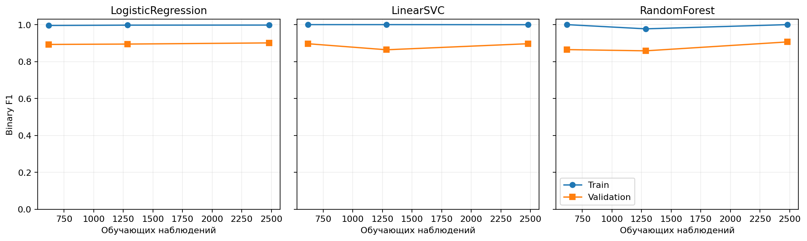

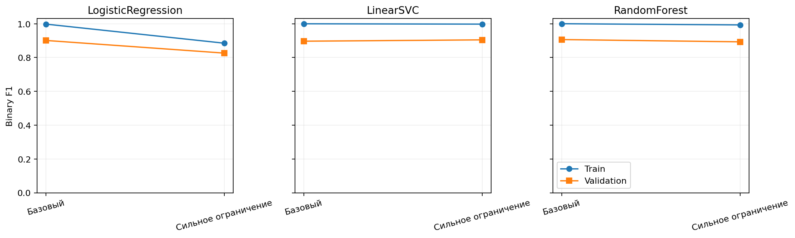

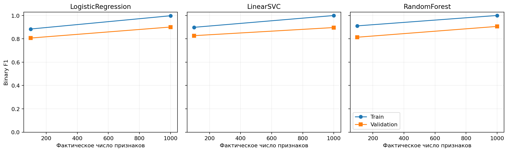

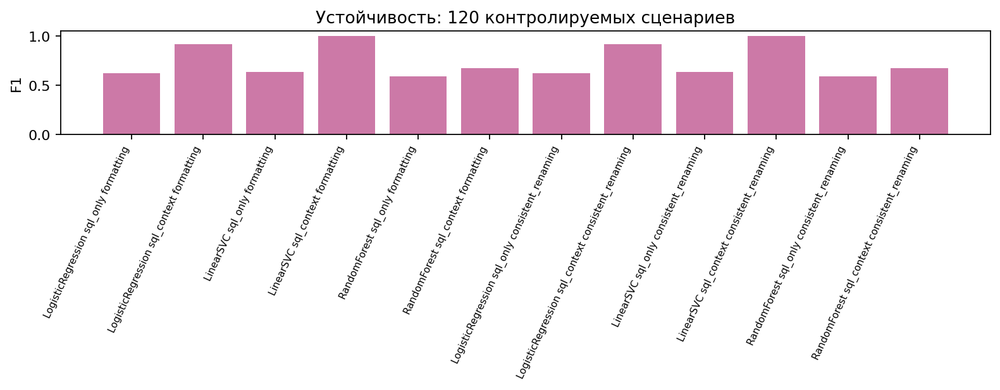

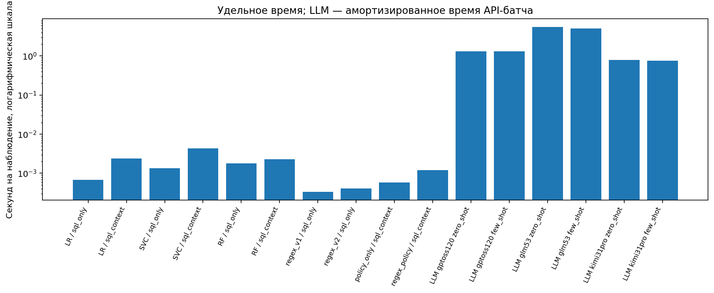

Кривые построены по небольшому числу фиксированных профилей. Изменение числа признаков не обязательно так же уменьшает сериализованный пайплайн: словарь до отбора может сохраняться в TF-IDF. Фактические размеры моделей и число столбцов находятся в `diagnostic_results.json`.

Для сокращённого LLM-профиля выполнено 34 новых API-вызовов, переиспользовано 37 готовых решений. До сокращения большого прогона было выполнено 124 обращений; они сохранены и не скрыты из истории расхода. Токены, задержки батчей и полное время с ожиданиями находятся в `timing_and_cost.json`. Цена аккаунта не установлена, поэтому денежная стоимость не выдумывается.

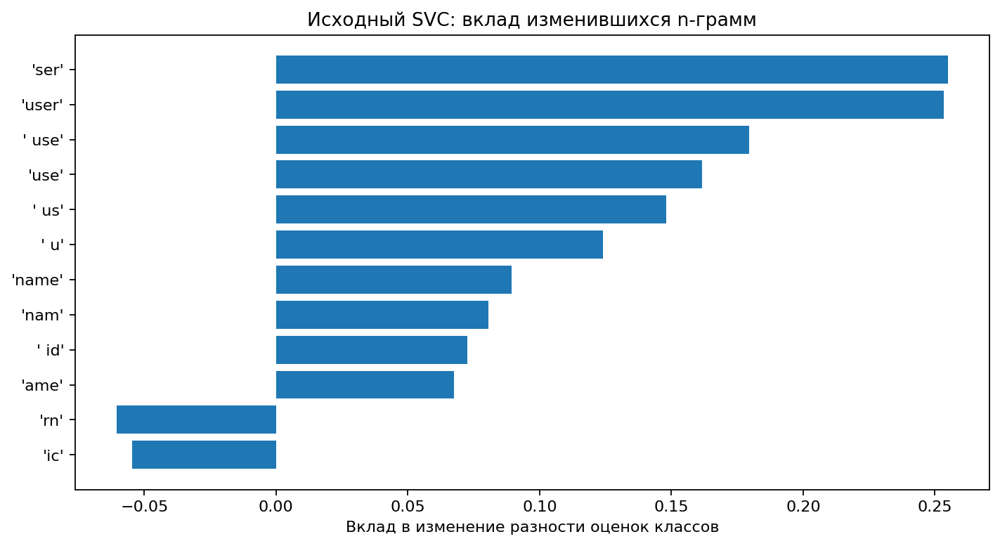

Для архивного SVC проверено точное восстановление разности оценок классов из весов активных n-грамм и смещения. В `linear_explanation.json` сохранены исходные пары запросов, оценки и вклады признаков; объяснение решения не является доказательством вредоносного намерения.

## Исторический контроль

Архивные модели и их метрики сохранены отдельно от новых бинарных моделей. Для проверки переноса сигнал исходной пяти-классовой модели определяется как «любая метка, кроме legit». Это преобразование решения, а не объявление старых исходных меток проверенной бинарной разметкой. Групповой NIRS holdout и исходные строковые CV/holdout имеют разные протоколы и выбор признаков; их нельзя интерпретировать как чистый эффект единственного изменения.

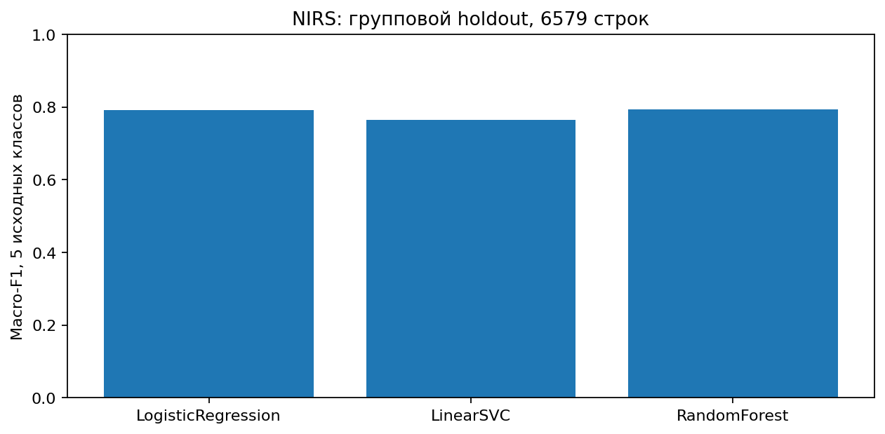

## Воспроизведение

```powershell
.\.venv\Scripts\python.exe -B src/evaluate.py --manifest results/preview/run_manifest.json
.\.venv\Scripts\python.exe -B src/compare.py --manifest results/preview/run_manifest.json
```

Эти команды читают зарегистрированные прогнозы PostgreSQL, пересчитывают результаты и создают графики без новых LLM-вызовов. Код сохранения проверяет закреплённые аннотации и test/validation принадлежность. В `audit_report.json` сверены метрики независимым расчётом sklearn и контрольные суммы связанных артефактов.

## Дальше: этап 13

После отдельного запуска полного профиля завершить все фолды, полный общий LLM-прогон и контекстную абляцию; затем заново построить все таблицы и графики новой версией отчёта. Текущие предварительные результаты сохраняются. Для независимого подтверждения изменений, сделанных после их просмотра, нужен ранее не использованный контроль.
